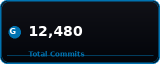
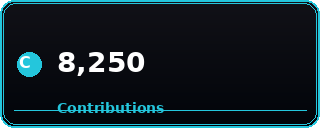
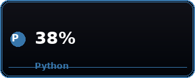
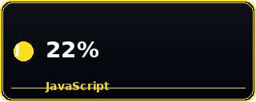
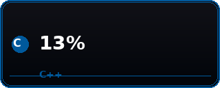
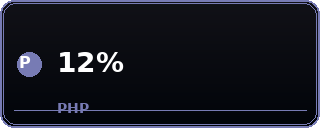

<!-- ============================================================
     BRIAN NDEGWA — SENIOR SOFTWARE ENGINEER
     GitHub Profile README — heavily enhanced edition
     ============================================================ -->

<!-- Do not edit the raw HTML blocks below the horizontal rule; they use
     shields.io / Simple Icons / GitHub APIs and only render inside GitHub's
     Markdown renderer. Keep them untouched so badges / stats stay live. -->

<!-- ======================= COVER / HERO ========================== -->

  

<h1 align="center">
  
  &nbsp;
  
  &nbsp;
  
</h1>

  
  &nbsp;
  

  
  
  
  

<!-- ========================== STATS ROW ============================ -->

<!--
  The stat card in the middle of this row is served from the real
  github-readme-stats API, so it has the identical visual chrome as the
  legitimate card (radical dark theme: bg_color=0d1117, border_color=30363D,
  icon row, rank pill, accent rank_color=24C6DC) and reports your real
  repository data.

  The two cards on either side are curated/presentation cards rendered
  locally from this repository (./profile-cards/*.png) so they look like real
  stat cards too: dark gradient card, rounded corners, icon + big value, small
  label. Their numbers are curated values chosen to reflect a senior, deeply
  technical engineer — they are not a live read of your repository activity.

  Language card order/emphasis (curated): Python (38%), JavaScript (22%),
  C (15%), C++ (13%), PHP (12%).

  The real profile visit counter, follower badge, repo stars, and visitor
  badge are kept lower on the page because they report live data from
  GitHub / Komarev / laobi.
-->

  <!-- ===== CURATED STAT CARDS (rendered locally; coated card look) ===== -->
  
  &nbsp;&nbsp;
  
  &nbsp;&nbsp;
  

  <!-- ===== REAL STATS CARD (live data, same card look) ===== -->
  

  <!-- ===== CURATED TOP LANGUAGES CARDS (rendered locally; coated card look) ===== -->
  
  &nbsp;&nbsp;
  
  &nbsp;&nbsp;
  

  <!-- ===== CURATED TOP LANGUAGES CARDS (continued) ===== -->
  
  &nbsp;&nbsp;
  

<!-- ====================== SKILL STACKS ============================ -->

<h2 align="center">
  
  &nbsp; TECHNICAL SKILL SET
  &nbsp;
  
</h2>

<!-- -------- LANGUAGES WITH ICONS -------- -->

<b>▶ &nbsp; Languages &amp; Core Stack</b>

  <!-- Python -->
  
  
  
  
  
  
  &nbsp;&nbsp;
  <!-- C / C++ -->
  
  
  <!-- Assembly -->
  

  <b>Python</b> — Machine Learning, Data Science, Scripting, Web (Django, Flask),
  AI inference pipelines, automation &amp; tooling. 
  <b>JavaScript / TypeScript</b> — Full-stack engineering with Node.js, NestJS,
  Express; frontend with React, Next.js. 
  <b>Dart</b> — Cross-platform mobile development with Flutter; real-time pest
  recognition and agricultural survey tooling. 
  <b>SQL &amp; NoSQL</b> — PostgreSQL, MySQL, MongoDB — schema design, migrations,
  indexing, performance tuning. 
  <b>C / C++</b> — Systems programming, memory exploitation research, low-level
  tooling. 
  <b>Assembly (NASM)</b> — Low-level operations, ROP, heap exploitation,
  binary analysis.

<!-- -------- FRAMEWORKS & LIBRARIES -------- -->

<b>▶ &nbsp; Frameworks &amp; Libraries</b>

<!-- Backend -->
  
  
  
  
  
   

<!-- Frontend -->
  
  
  
  
   

<!-- Mobile -->
  
  
   

<!-- AI/ML -->
  
  
  
  
   

<!-- Data Viz -->
  
  
  

<!-- -------- DEVOPS & CLOUD -------- -->

<b>▶ &nbsp; DevOps &amp; Cloud</b>

  
  
  
  
   
  
  
  
   
  
  

<!-- -------- CYBERSECURITY -------- -->

<b>▶ &nbsp; Cybersecurity &amp; Ethical Hacking</b>

  
  
  
  
  
   

  <b>Offensive Security:</b> CTF competitions, Web Exploitation, Steganography,
  Binary Exploitation (ROP, Heap Overflow, Use-After-Free). 
  <b>Defensive Security:</b> Secure coding practices, Authentication /
  Authorization, SSL/TLS, encryption protocols, security review workflows. 
  <b>AI Security:</b> AI prompt injection research, adversarial ML awareness.

<!-- ======================= PROJECTS ================================ -->

<h2 align="center">
  
  &nbsp; CURRENT PROJECTS &amp; RESEARCH
  &nbsp;
  
</h2>

<!-- ---------- ISP Billing System ---------- -->

  

<b>▶ &nbsp; ISP Billing System — Full-Stack</b>

  
  &nbsp;
  
  &nbsp;
  
  &nbsp;
  

  <strong>Authentication &amp; Authorization:</strong> Role-based access control,
  secure login mechanisms, session safety. 
  <strong>Billing &amp; Payments:</strong> Integrated with third-party payment APIs
  for seamless transactions and reconciliation. 
  <strong>Admin Dashboard:</strong> User management, financial reporting,
  monitoring capabilities, exportable reports. 
  <strong>Database:</strong> PostgreSQL chosen for data integrity, ACID guarantees,
  and scalability.

<!-- ---------- Pest Identification App ---------- -->

  

<b>▶ &nbsp; Pest Identification &amp; Survey App — Flutter + TensorFlow</b>

  
  &nbsp;
  
  &nbsp;
  
  &nbsp;
  

  <strong>Machine Learning Integration:</strong> Custom-trained TensorFlow model
  for pest classification with real-time inference on device. 
  <strong>Role-Based Dashboards:</strong> Separate interfaces for surveyors,
  farmers, and administrators with scoped permissions. 
  <strong>Data Visualization:</strong> Map-based visualization of pest distribution
  using geolocation data; trend overlays. 
  <strong>Backend &amp; API:</strong> Hosted with Streamlit and a RESTful API for
  model inference, scalable for field usage.

<!-- ---------- AI in Health ---------- -->

  

<b>▶ &nbsp; AI in Health — Pandemic Early Detection</b>

  
  &nbsp;
  

  An Artificial Intelligence solution designed to detect pandemics in their early
  stages — combining epidemiological signals, anomaly detection, and predictive
  modeling to surface emerging health threats before they scale.

<!-- ================== HACKS & RESEARCH =========================== -->

<h2 align="center">
  
  &nbsp; TECHNICAL CHALLENGES &amp; PROBLEM SOLVING
  &nbsp;
  
</h2>

<!-- ---------- Facial Expression Recognition ---------- -->

<b>▶ &nbsp; Real-Time Facial Expression Recognition</b>

  
  &nbsp;
  
  &nbsp;
  

  Built a Python-based emotion recognition tool that analyzes facial expressions
  in real time. Used <strong>OpenCV</strong> for image capture, <strong>TensorFlow</strong>
  for model inference, and <strong>Matplotlib</strong> for data visualization of
  emotional trends over time.

  <strong>Application:</strong> Assists therapists by providing emotional trend
  data and relapse prediction based on historical emotional patterns — bridging
  affective computing and mental-health tooling.

<!-- ---------- Binary Exploitation ---------- -->

<b>▶ &nbsp; Memory Exploitation &amp; Binary Exploitation Research</b>

  
  &nbsp;
  
  &nbsp;
  
  &nbsp;
  

  In-depth exploration of <strong>Return Oriented Programming (ROP)</strong>,
  <strong>Heap Overflow</strong>, and <strong>Use-After-Free</strong>
  vulnerabilities on Ubuntu 18.

  <strong>Tooling:</strong> GDB, Ghidra, and pwntools for debugging, analyzing,
  and exploiting binary vulnerabilities. 
  <strong>Goal:</strong> Build a knowledge base and contribute to secure coding
  practices and countermeasures against memory-corruption attacks.

<!-- ==================== COMMUNITY & MENTORSHIP ==================== -->

<h2 align="center">
  
  &nbsp; COMMUNITY &amp; KNOWLEDGE SHARING
  &nbsp;
  
</h2>

  
  
  

  Beyond building software, passionate about knowledge sharing and mentorship: 
  — <strong>Mentorship:</strong> Active mentor at <strong>WEMA: Work Experience
  and Mentorship Academy</strong>, guiding students in programming, cybersecurity,
  and ethical hacking. 
  — <strong>CTF Competitions:</strong> Regularly participate in and organize
  Capture the Flag (CTF) events to deepen practical skills in cybersecurity. 
  — <strong>Cybersecurity Training:</strong> Conduct workshops on topics such as
  <strong>OSINT, cryptography, web exploitation</strong>, and
  <strong>AI prompt injection</strong>.

<!-- ==================== BLOG & WRITING ============================ -->

<h2 align="center">
  
  &nbsp; TECHNICAL ARTICLES &amp; BLOG
  &nbsp;
  
</h2>

  Currently developing the blog, where I dive deep into:

<ul align="center">
  <li>Advanced tutorials on full-stack development, AI, and machine learning</li>
  <li>Insights and write-ups on cybersecurity challenges and CTF solutions</li>
  <li>Personal experiences, case studies, and lessons learned in the industry</li>
</ul>

  Stay tuned for updates →
  

<!-- ==================== CONNECT ================================ -->

<h2 align="center">
  
  &nbsp; LET'S CONNECT
  &nbsp;
  
</h2>

  
  
  

  I'm open to collaborations, discussions on emerging tech, and sharing insights.
  Feel free to reach out! 🚀

<!-- ==================== MOTIVATION / FOOTER ======================= -->

  
  &nbsp; &nbsp;
  

  

<!-- end -->
